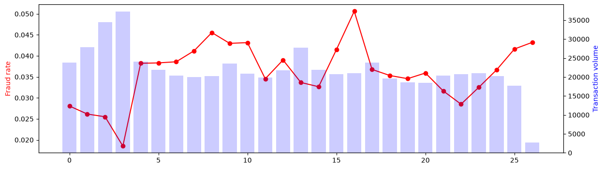
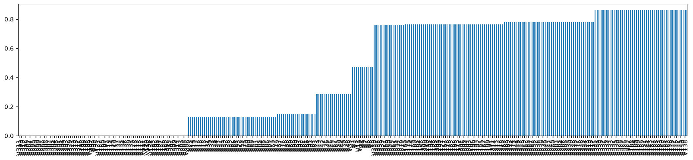
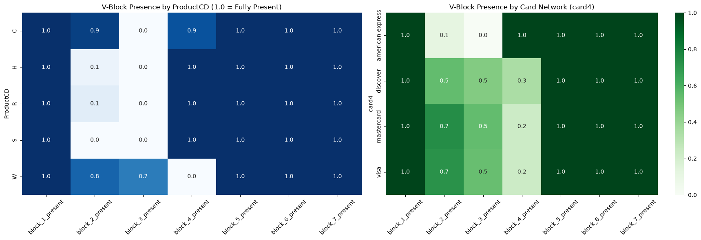
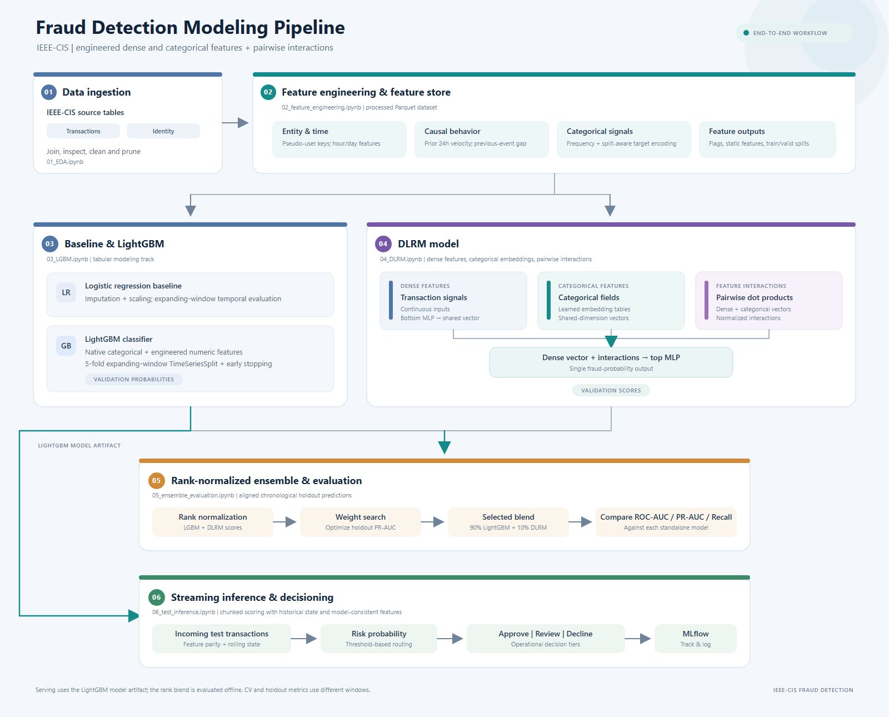
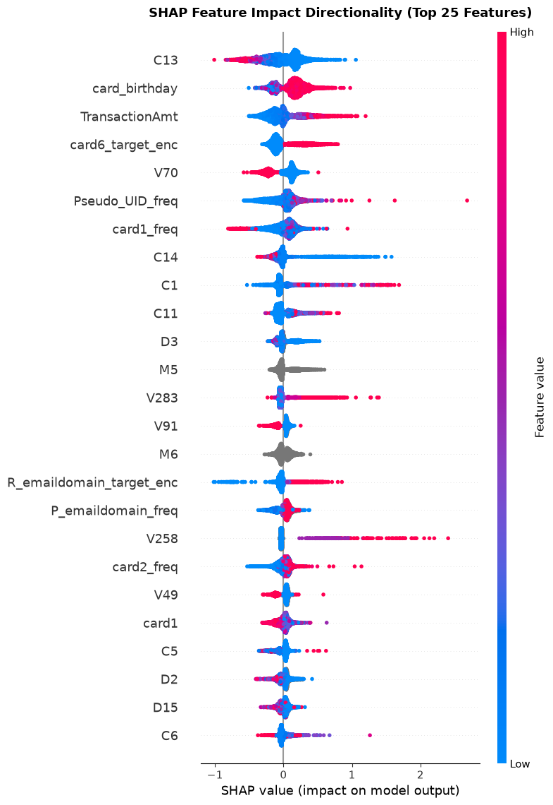
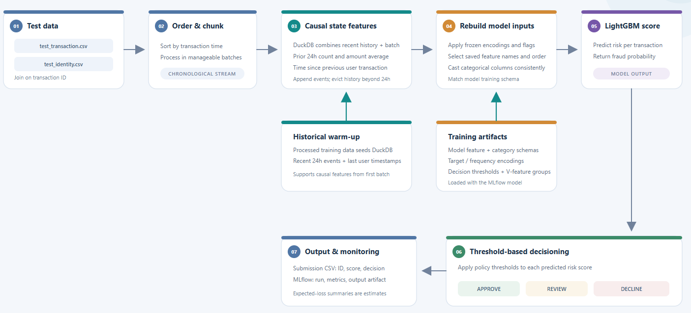

## Vesta IEEE-CIS Credit Card Fraud Detection (Kaggle)

> 🛡️ [**Check this interactive fraud policy Streamlit simulator**](https://ieee-fraud-detection-ko3lrqtytuxgtienjoeqiv.streamlit.app/)

### Business problem

Vesta Corporation is a global protection and payment solutions company
specializing in telecom and mobile commerce. It provides a dataset of online
e-commerce transactions, with the goal of predicting the probability that a
transaction is fraudulent.

Source: [Kaggle IEEE-CIS Fraud Detection](https://www.kaggle.com/competitions/ieee-fraud-detection)

Key points:

- Failing to detect fraud leads to capital loss (chargebacks, fines, and lost
  transaction revenue) and reputational damage.
- Overly aggressive fraud controls increase false-positive rejections of
  legitimate customers and degrade revenue.

The goal is to minimize missed fraud while keeping legitimate customers
undisrupted by analyzing expected losses and savings for the merchant.

### Data description

#### Transactions table

The transaction dataset captures behavioral, payment, and network-level
attributes. Because raw customer identifiers are masked for privacy, features
are partitioned into structured domain groups:

| Feature / Group | Type | Description |
| :--- | :--- | :--- |
| **`TransactionDT`** | Numeric (Integer) | Monotonically increasing timedelta (in seconds) from an undisclosed reference datetime. |
| **`TransactionAmt`** | Numeric (Float) | Transaction payment amount in USD. |
| **`ProductCD`** | Categorical | Discrete code representing the product or service category of the purchase. |
| **`card1` – `card6`** | Categorical / Numeric | Payment card metadata (e.g., Bank Identification Number [BIN], card network/brand, card tier, issuer country). |
| **`addr1`, `addr2`** | Categorical (Masked) | Geographic billing and delivery regions (e.g., zip/postal code clusters, regional area codes). |
| **`dist1`, `dist2`** | Numeric (Continuous) | Approximate physical distance (e.g., billing address vs. shipping address, or billing address vs. transaction IP). |
| **`P_emaildomain` `R_emaildomain`** | Categorical | Email domain of the purchaser (`P_`) and recipient (`R_`). |
| **`C1` – `C14`** | Numeric (Discrete Counts) | Masked counting features (e.g., frequency of phone numbers, emails, or cards tied to an account). |
| **`D1` – `D15`** | Numeric (Timedelta Days) | Relative time deltas representing days since prior events (e.g., days since card activation, days since last order). |
| **`M1` – `M9`** | Categorical (Boolean/Match) | Match verification flags comparing names, billing addresses, and delivery recipients. |
| **`V1` – `V339`** | Numeric (Engineered) | Relational and entity features engineered by Vesta (rankings, co-occurrence frequencies, aggregation ratios). |

#### Identity table

| Feature / Group | Type | Description |
| :--- | :--- | :--- |
| **`TransactionID`** | Numeric (Integer) | Primary key linking identity metadata back to the `Transactions` table. |
| **`id_01` – `id_11`** | Numeric (Continuous) | Numerical device signals (e.g., screen dimensions, resolution ratios, proxy/VPN ping times, battery/OS hardware offsets). |
| **`id_12`** | Categorical | Indicator denoting whether proxy or IP masking software was detected (`NotFound` vs. `Found`). |
| **`id_13` – `id_14`** | Numeric / Categorical | Network connection attributes, IP port categories, and client-side time-zone offsets. |
| **`id_15` – `id_16`** | Categorical | Browser status indicators (e.g., incognito/private mode detection, authorization session continuity). |
| **`id_17` – `id_22`** | Categorical / Numeric | Extended device and network configurations (ISP routing signatures, connection types, SIM/cellular attributes). |
| **`id_23`** | Categorical | IP proxy level categorization (e.g., `IP_PROXY:TRANSPARENT`, `IP_PROXY:ANONYMOUS`, `IP_PROXY:HIDDEN`). |
| **`id_24` – `id_26`** | Numeric | Telemetry consistency indicators measuring hardware-to-network match confidence. |
| **`id_27` – `id_29`** | Categorical | Account and authorization verification states (`NotFound` vs. `Found`). |
| **`id_30`** | Categorical | Operating system name and version (e.g., `iOS 11.1.2`, `Windows 10`, `Android 7.0`, `Mac OS X`). |
| **`id_31`** | Categorical | Client browser name and engine release (e.g., `chrome 63.0`, `mobile safari 11.0`, `firefox 57.0`, `edge 16.0`). |
| **`id_32`** | Numeric | Screen color bit-depth (e.g., `24`, `32`, `16`). |
| **`id_33`** | Categorical | Display resolution string formatted as width by height (e.g., `1920x1080`, `2208x1242`, `1366x768`). |
| **`id_34`** | Categorical | Match indicator between declared device OS and detected browser user-agent string. |
| **`id_35` – `id_38`** | Categorical (Boolean) | Client security and environment flags (`T` / `F`) verifying cookies, JavaScript execution, and login status. |
| **`DeviceType`** | Categorical | High-level client hardware classification (`desktop`, `mobile`). |
| **`DeviceInfo`** | Categorical | Raw device build model or hardware manufacturer string (e.g., `SM-G935F`, `iOS Device`, `Windows`, `Trident/7.0`). |

These features are collected by Vesta's fraud protection system and digital
security partners. Field names are masked; a pairwise dictionary is not
provided for privacy protection and contractual reasons.

### Key metrics

The evaluation uses ROC-AUC and PR-AUC, Precision and Recall, which are useful for imbalanced datasets:

- **ROC-AUC** measures how well the model ranks fraud above legitimate
  transactions across the full dataset using the true-positive and
  false-positive rates. Because 96.5% of transactions are legitimate, ROC-AUC
  can look artificially high (0.90+) even when the model generates many false
  alarms.
- **PR-AUC** focuses on fraud precision and recall: whether flagged
  transactions are actually fraudulent and how many fraud cases are caught.
  This makes it a stricter, more realistic metric for rare fraud events.
- **Recall** focuses on missed fraud: It measures what proportion of actual fraudulent transactions the model successfully caught. High recall minimizes financial loss by ensuring fraudulent activity does not slip through undetected.  
- **Precision** focuses on false alarms: It measures what proportion of flagged transactions were actually fraudulent. In a rare-event scenario, high precision protects legitimate customers from unnecessary transaction declines. 

### EDA insights

1. **Severe target imbalance.** The training dataset has 3.5% fraudulent
   transactions, so metrics such as PR-AUC and ROC-AUC are more informative
   than raw accuracy.
2. **Time-split structure.** `TransactionDT` is continuous chronological time;
   random k-fold validation can leak future information. Time-series splits or
   group-based temporal folds better mirror test performance.
3. **Fraud is not stationary over time.** The overall fraud rate fluctuates
   between approximately 2.5% and 4.8%, with some weeks showing spikes.

   
4. **User ID reconstruction.** Fraud can occur in bursts from connected users.
   Since the dataset omits account identifiers for privacy, a pseudo-ID can be
   reconstructed from identity fields such as card metadata, address, and
   email domain. This allows user-level cumulative and rolling spend and
   transaction velocity to be measured:

   > $$\text{Pseudo}_{\text{UID}} = \text{card1} \parallel \text{card2} \parallel \text{card3} \parallel \text{card4} \parallel \text{card5} \parallel \text{card6} \parallel \text{addr1} \parallel \text{email domain} \parallel \text{Card birthday}$$

5. **Rolling statistics for a 24-hour user window.** Sudden fraud spikes and
   deviations from a user's average transaction frequency are useful
   behavioral signals. Transactions were grouped chronologically by pseudo-ID
   using a 24-hour window.
6. **Missingness in V-features is informative.** Vesta-created V-features have
   identical null patterns that correspond to particular logging systems:

   

   The resulting decisions were to cluster V-features by missingness blocks,
   reduce collinearity within each block (drop features with over 90%
   correlation), and analyze whether these clusters vary across product types
   and payment systems. Missingness flags were retained where useful to
   distinguish unavailable features from noise.

   

   - W uses a fundamentally different payment-processing pipeline compared
     with H, R, and S.
   - Amex bypasses traditional third-party banking verification checks used
     by Visa and Mastercard.

### Machine learning pipeline structure

### Hyper-Parameters for LGBM and DLRM  

LightGBM 

| Hyperparameter | Value |
| :--- | :--- |
| *objective* | `'binary'` |
| *metric* | `'auc'` |
| *boosting_type* | `'gbdt'` |
| *learning_rate* | `0.03` |
| *num_leaves* | `127` |
| *max_depth* | `-1` |
| *feature_fraction* | `0.8` |
| *subsample* | `0.8` |
| *random_state* | `SEED` |
| *n_jobs* | `-1` |
| *verbose* | `-1` |

DLRM 

| Hyperparameter | Value |
| :--- | :--- |
| *embedding_dim* | `16` |
| *bottom_mlp_dims* | `[256, 128, 16]` |
| *top_mlp_dims* | `[256, 128, 1]` |
| *activation* | `'relu'` |
| *interaction_type* | `'dot'` |
| *dropout* | `0.2` |
| *optimizer* | `'AdamW'` |
| *learning_rate* | `1e-3` |
| *weight_decay* | `1e-4` |
| *scheduler* | `ReduceLROnPlateau` |
| *batch_size* | `1024 train, 2048 eval (GPU)` |
| *loss_function* | `'BCEWithLogitsLoss'` |
| *epochs* | `15` |
| *early_stopping_patience* | `3` |

### Training results

| Model / evaluation | ROC-AUC | PR-AUC | Recall | Precision |
|---|---:|---:|---:|---:|
| Logistic regression  | 0.82788 | 0.39200 | 0.52989 | 0.24009 |
| LightGBM | 0.91670 | 0.59896 | 0.50276 | 0.67334 |
| DLRM | 0.87440 | 0.53673 | 0.54907 | 0.46737 |

#### Takeaways

- DLRM captures feature interactions effectively, but still trails LightGBM: by learning dense embeddings for high-cardinality categorical variables (like card_id, addr, and device_id) and explicitly modeling pairwise dot-product interactions with dense features, DLRM effectively handles tabular fraud data. However, it still falls slightly short of LightGBM because gradient-boosted decision trees naturally partition unnormalized continuous features and tabular split boundaries. 
- **Final model selection: LightGBM.**

### SHAP analysis

- Velocity and activity counters (C features) influence decisions; high counts
  push predictions toward fraud.
- Higher transaction amounts increase predicted fraud probability.
- Engineered features (card birthday, pseudo-ID frequency, and card-vendor
  frequency) are effective: newer cards correlate with risk, while low
  frequencies do not automatically trigger fraud predictions.
- Some V-features trigger fraud risk.
- Target encodings show that high historical fraud rates for a category
  increase risk for a transaction.

### Inference logic and business metrics

- Raw model probabilities are initially translated into three actions
  (Approve, Review, Decline) using heuristic thresholds of 0.05 for review and
  0.35 for decline. These are later replaced by cost-optimized thresholds.
- Business metrics include a €2.50 cost per manual audit and a €15 chargeback
  fee, added to the transaction amount if a fraudulent transaction is approved
  or missed in review.

### Business impact: cost-sensitive Bayes decision theory

The model supplies the **posterior fraud probability**
$p = P(\text{fraud} \mid x)$. Bayes decision theory chooses the action with the
**lowest posterior expected cost** for each transaction. The model estimates;
the cost structure decides.

Notation:  
* $A$: Transaction amount  
* $F = A + \text{Fee}_{\text{cb}}$: Financial exposure if fraud gets through  
* $C_{\text{audit}}$: Cost per manual review  
* $c$: Human catch rate (recall)  
* $C_{\text{churn}}$: Cost of wrongly declining a legitimate customer  

| Action | Expected cost | Interpretation |
| :--- | :--- | :--- |
| Approve | $E[\text{Cost}_\text{Approve}] = p \cdot F$ | If fraud, lose the amount plus chargeback fee; if legitimate, cost is 0. |
| Review | $`E[\text{Cost}_\text{Review}] = C_\text{audit} + p(1 - c)F`$ | Always pay the audit; fraud is lost only if the reviewer misses it. |
| Decline | $`E[\text{Cost}_\text{Decline}] = (1 - p) \cdot C_\text{churn}`$ | If legitimate, lose a customer; if fraud, cost is 0. |

An action is selected only if its expected cost is strictly lower than the
expected cost of the alternatives.

#### Three-action cost equations

1. **Auto-approve**

  $$E[\text{Cost}_{\text{Approve}}] = p \cdot (A + \text{Fee}_{\text{cb}})$$

  If the transaction is fraudulent, the loss is the amount plus chargeback
  fee; if legitimate, the cost is €0.

2. **Auto-decline**

  $$E[\text{Cost}_{\text{Decline}}] = (1 - p) \cdot \text{Cost}_{\text{churn}}$$

  If the transaction is legitimate, the business loses the customer and
  lifetime value; if fraudulent, the cost is €0.

3. **Manual review**

  $$E[\text{Cost}_{\text{Review}}] = C_{\text{audit}} + p \cdot (1 - c) \cdot (A + \text{Fee}_{\text{cb}})$$

  The audit cost is always paid, plus residual fraud loss if the human
  reviewer misses the fraud.

**Breakeven rule:** When $`(A + \text{Fee}_{\text{cb}}) \le C_{\text{audit}}`$,
bypass manual review because inspecting costs more than the total exposure.
Route directly to approve or decline, whichever has lower expected cost.

#### Assumption: calibrated probabilities

Expected costs are computed with the model's own probabilities, so the policy
is optimal only if $p$ is well calibrated (e.g., assessed with a reliability
curve or Brier score, and recalibrated with isotonic or Platt scaling if
needed). The scored test set has no fraud labels, so reported savings are
*expected* values, not realized ones.

## Executive summary of business impact

The test set spans approximately six months and is chronological after the
training dataset. Instead of relying on an arbitrary $0.5$ classification
threshold or static heuristic cutoffs, decisions are governed by
**Cost-Sensitive Bayes Decision Theory**. The policy assigns one of three
operational actions (Approve, Review, Decline) to minimize total expected
portfolio cost, subject to a review-capacity constraint:

$$\min_{T_{\text{approve}}, T_{\text{decline}}} \sum_{i} \Big( E[\text{Cost}_{\text{Approve}}] + E[\text{Cost}_{\text{Review}}] + E[\text{Cost}_{\text{Decline}}] \Big) \quad \text{s.t. review rate} \le \text{capacity}$$

### Economic constraints

- **Manual review OpEx ($C_{\text{audit}}$):** €2.50 per ticket |
  **Human recall:** 90%
- **Chargeback fee ($\text{Fee}_{\text{cb}}$):** €15.00 per incident |
  **Customer churn cost:** €10.00
- **Breakeven gating rule:** When $`(A + \text{Fee}_{\text{cb}}) \le C_{\text{audit}}`$, manual review is bypassed because inspecting costs more
  than the total exposure. Transactions are routed directly to Approve or
  Decline based on expected loss. The capacity constraint also matters:
  without it, the Bayes rule would send every transaction with $p$ above the
  review break-even to the queue.

### Decision performance on inference

| Metric | Cost-optimized policy ($T \in [0.0386, 0.2431]$) | Business interpretation |
| :--- | :--- | :--- |
| **Auto-Approve Rate** | **84.57%** (428,509 txns) | Preserves revenue |
| **Manual Review Rate** | **12.10%** (61,318 txns) | Queue capacity control and staffing budget |
| **Hard Decline Rate** | **3.33%** (16,864 txns) | Fraud mitigation |
| **Gross Prevented Loss** | **€1,576,806.88** | Chargeback capital and dispute fees preserved |
| **Review Queue OpEx** | **€153,295.00** | Direct manual review labor incurred |
| **Policy ROI** | **€10.29 saved / €1 spent** | Capital saved per €1.00 of review labor |

### Key takeaways

1. **Capital protection efficiency:** Hard-declining 3.33% of transactions
   (16,864 txns) eliminates **€1,576,806.88** in gross fraud exposure, yielding
   average capital savings of **€93.50 per automated decline**.
2. **Operational leverage:** Manual review covers 12.10% of volume (61,318
   txns) at a cost of **€153,295.00**, delivering **€10.29 saved per €1.00**
   spent on investigation labor.
3. **Review constraint:** The manual-review cost rule keeps transactions out
   of review when the potential fraud loss does not justify the inspection
   cost, reserving audit resources for higher-value cases.

All figures are expected values based on predicted probabilities, not labels
from the scored test set. They depend on model calibration and the assumed
cost parameters.
